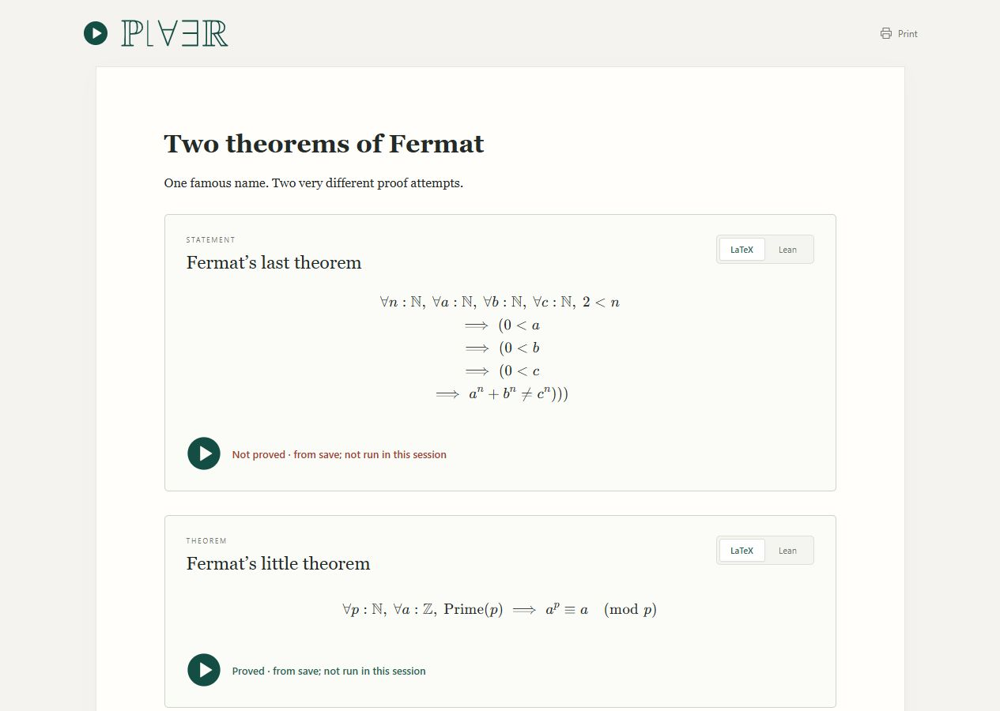

<p align="center">
  
</p>

<p align="center"><strong>Proof Left As an Exercise for the Reader.</strong></p>
<p align="center">Read definitions and theorem statements from Lean, with mathematical notation and your own application notes.</p>

<p align="center">
  <a href="docs/getting-started.md">Get started</a> ·
  <a href="docs/authoring.md">Write a document</a> ·
  <a href="docs/architecture.md">How it works</a> ·
  <a href="docs/development.md">Development</a>
</p>

## What you can do today

PLAER is a prototype for reading formal mathematics. It renders statements from
Lean as LaTeX, lets you switch to their Lean statements, and provides editable
Markdown cells for explanations and application notes. Application connections
are notes you write yourself; PLAER does not generate them automatically.

The included Fermat document demonstrates two statements and optional proof
checks: an intentionally invalid attempt at the last theorem, and a checked
proof of the little theorem. The proof controls are a supporting feature; the
reading experience centers on definitions and statements.



## View the example

Clone this repository, or choose **Code → Download ZIP** on GitHub and extract it.

```sh
git clone https://github.com/AthenaCaesura/PLAER.git
cd PLAER
```

Open **[dist/index.html](dist/index.html)** from your downloaded folder in a
browser. The document includes its scripts, styles, fonts, and logos. Viewing it
requires no Lean installation. GitHub's file viewer displays the HTML source;
download the repository to open the actual document.

Offline proof results are saved results. For fresh Lean checks and saving notes
back to source, follow the [local setup guide](docs/getting-started.md).

## Develop locally

After installing Python and Lean as described in the setup guide:

```sh
python scripts/build.py
python scripts/serve.py
```

On macOS or Ubuntu, use `python3` if that is your Python command. Open
**http://127.0.0.1:8767/**. The first build downloads Lean dependencies, and
server startup loads Mathlib. Both can take a few minutes.

Windows, macOS, and Ubuntu are covered by the
[cross-platform CI workflow](https://github.com/AthenaCaesura/PLAER/actions/workflows/ci.yml).
Run the complete local suite with `python scripts/check.py` (Python, Lean, and
Node.js required).

## Find your way around

| Location | Purpose |
| --- | --- |
| [Paper.lean](Paper.lean) | The current document: choose the statements to display. |
| [Explanations/](Explanations/) | Editable Markdown explanation and application-note cells. |
| [Plaer/](Plaer/) | Lean statement extraction, notation, document rendering, and checks. |
| [web/](web/) | Browser interface and canonical SVG branding assets. |
| [scripts/](scripts/) | Build, packaging, local server, and check commands. |
| [tests/](tests/) | Lean, Python, and JavaScript regression tests. |
| [docs/](docs/) | Setup, authoring, architecture, and development guides. |
| [design/logo/](design/logo/) | Reproducible wordmark source and glyph provenance. |
| [vendor/LeanTeX/](vendor/LeanTeX/) | The included LeanTeX source fork and its license. |
| [dist/](dist/) | The self-contained document and build provenance. |

`Main.lean` and `Worker.lean` are small entry points for document generation and
the live Lean checker. Standard Lake configuration stays at the repository root.

## Renderer and attribution

PLAER uses a local fork of [Kyle Miller's LeanTeX](https://github.com/kmill/LeanTeX),
ported to Lean 4.35.0. Mathematical notation is generated from elaborated Lean
expressions. Unsupported notation is rejected rather than guessed.

See the [architecture guide](docs/architecture.md),
[fork notes](vendor/LeanTeX/FORK.md), and
[third-party notices](THIRD_PARTY_NOTICES.md) for the implementation and licensing.
